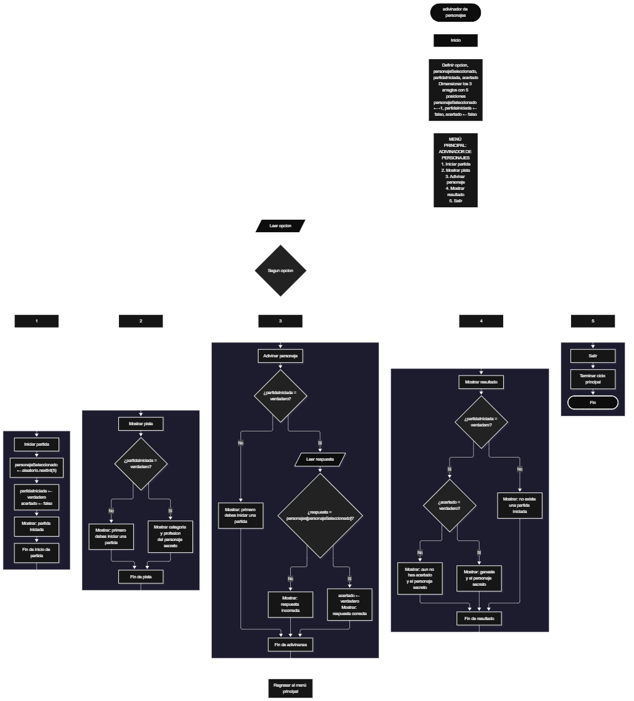

Este proyecto, llamado <b>adivinador de personajes</b>, fue desarrollado en <b>java</b> como un ejercicio práctico para fortalecer la lógica de programación mediante la creación de un juego de adivinanza desde la consola. El programa cuenta con un menú principal de cinco opciones que permite <b>iniciar una partida, mostrar pistas, adivinar el personaje, mostrar el resultado y salir</b>. Cada partida selecciona de forma aleatoria un personaje secreto entre <b>5 personajes registrados</b>, utilizando arreglos que almacenan el nombre, la categoría y la profesión de cada uno. Durante su desarrollo se aplicaron conceptos fundamentales de programación, como variables, arreglos, estructuras condicionales, ciclos repetitivos y estructuras de selección, además de procesos para generar números aleatorios, leer datos del usuario y comparar textos. Este proyecto permite poner en práctica los conocimientos adquiridos en java y sirve como base para desarrollar juegos y sistemas más avanzados utilizando otros lenguajes y tecnologías.

<h2 align="center">⚙️ Funcionamiento del menú principal</h2>

### 🎮 Iniciar partida

La opción <b>1) iniciar partida</b> permite comenzar un nuevo juego. Al seleccionarla, el programa genera una posición aleatoria dentro del arreglo de personajes mediante <b>aleatorio.nextInt(personajes.length)</b> y la almacena en la variable <b>personajeSeleccionado</b>. Después, cambia la variable <b>partidaIniciada</b> a <b>true</b> y la variable <b>acertado</b> a <b>false</b>, para que cada partida comience desde cero. Finalmente, muestra los mensajes <b>"Partida iniciada."</b> y <b>"Se ha seleccionado un personaje secreto."</b>. Esta opción puede ejecutarse varias veces para jugar con un personaje diferente.

### 💡 Mostrar pista

La opción <b>2) mostrar pista</b> permite obtener información sobre el personaje secreto. Primero, el programa comprueba que exista una partida iniciada mediante la condición <b>!partidaIniciada</b>. Si no existe, muestra el mensaje <b>"Primero debes iniciar una partida."</b> y regresa al menú. En caso contrario, utiliza el valor de <b>personajeSeleccionado</b> como posición para consultar los arreglos <b>categorias</b> y <b>profesiones</b>, y muestra dos pistas: <b>Pista 1</b>, con la categoría del personaje, y <b>Pista 2</b>, con su profesión.

### 🔎 Adivinar personaje

La opción <b>3) adivinar personaje</b> permite al jugador intentar descubrir el personaje secreto. Antes de continuar, el programa comprueba que exista una partida iniciada. Si la partida existe, solicita el nombre del personaje y lo compara con <b>personajes[personajeSeleccionado]</b> mediante el método <b>equalsIgnoreCase</b>, lo que permite aceptar la respuesta sin importar si se escribe en mayúsculas o minúsculas. Si el nombre coincide, cambia la variable <b>acertado</b> a <b>true</b> y muestra el mensaje <b>"Respuesta correcta."</b>. Si no coincide, presenta el mensaje <b>"Respuesta incorrecta."</b> y el jugador puede volver a intentarlo.

### 🏆 Mostrar resultado

La opción <b>4) mostrar resultado</b> permite consultar el estado de la partida actual. Primero, el programa comprueba si existe una partida iniciada. Si no existe, muestra el mensaje <b>"No existe una partida iniciada."</b>. En caso contrario, evalúa la variable <b>acertado</b>. Si es verdadera, presenta el mensaje <b>"Resultado: Ganaste."</b> junto con el nombre del personaje. Si todavía no se ha acertado, presenta el mensaje <b>"Resultado: Aun no has acertado."</b> y también muestra el personaje secreto.

### 🚪 Salir del menú principal

La opción <b>5) salir</b> finaliza la ejecución del programa y muestra el mensaje <b>"Gracias por jugar Adivinador de Personajes."</b>. El menú principal se encuentra dentro de una estructura repetitiva <b>do-while</b>, que mantiene el programa en funcionamiento mientras se cumpla la condición <b>opcion != 5</b>. Cuando el usuario selecciona la opción 5, la condición deja de cumplirse, el ciclo termina y el programa cierra el objeto <b>Scanner</b> con <b>entrada.close()</b>.

<h2 align="center">🧠 Temas aplicados en el proyecto</h2>

### 📦 Variables

En este proyecto se utilizan variables para guardar la opción seleccionada en el menú, almacenar la posición del personaje secreto, controlar si la partida ya fue iniciada, comprobar si el jugador acertó y guardar el nombre que escribe el jugador al adivinar. Cada variable cumple una función específica dentro del juego.

🔢 **opcion:** Almacena la opción seleccionada por el usuario en el menú principal.

🎯 **personajeSeleccionado:** Almacena la posición del personaje secreto. Su valor inicial es <b>-1</b>, lo que indica que todavía no existe una partida.

🚦 **partidaIniciada:** Variable lógica que indica si el jugador ya inició una partida.

✅ **acertado:** Variable lógica que indica si el jugador adivinó el personaje secreto.

💬 **respuesta:** Almacena el nombre del personaje que escribe el jugador.

### 🗃️ Arreglos

En este proyecto se utilizan tres arreglos relacionados con los datos de cada personaje. Cada arreglo tiene una capacidad de <b>5 posiciones</b> y utiliza el mismo índice para representar la información correspondiente a un mismo personaje. Por ejemplo, los datos de Batman, almacenado en la posición <b>1</b>, se encuentran distribuidos entre <b>personajes[1], categorias[1] y profesiones[1]</b>. Esta organización permite que, con una sola posición aleatoria, el programa obtenga el nombre y las pistas del personaje secreto.

📝 **personajes[5]:** Almacena los nombres de los personajes: Mario, Batman, Spider-Man, Superman y Sonic.

🎬 **categorias[5]:** Almacena la categoría de cada personaje: Videojuegos o Comics.

💼 **profesiones[5]:** Almacena la profesión de cada personaje: Plomero, Superheroe o Velocista.

### 🔀 Estructuras condicionales

En este proyecto se utilizan las estructuras <b>if</b>, <b>else if</b> y <b>else</b> para comprobar si existe una partida iniciada antes de mostrar pistas, recibir respuestas o mostrar el resultado, determinar si la respuesta del jugador es correcta o incorrecta y decidir qué resultado se presenta al consultar el estado de la partida. Estas condiciones permiten que el programa responda de manera diferente según el estado del juego.

### 🔄 Estructuras repetitivas

En este proyecto se utiliza el ciclo <b>do-while</b>, que mantiene activo el menú principal para que el usuario pueda ejecutar diferentes operaciones antes de salir del programa. Al evaluar la condición al final de cada repetición, el ciclo garantiza que el menú se muestre al menos una vez y que se repita hasta que el usuario seleccione la opción <b>5</b>.

### 🎯 Estructura switch

El programa evalúa el valor almacenado en la variable <b>opcion</b> y ejecuta el bloque de instrucciones correspondiente. Cada caso representa una operación específica del juego: <b>iniciar partida, mostrar pista, adivinar personaje, mostrar resultado o salir</b>. Cada bloque finaliza con la instrucción <b>break</b>. También se utiliza el bloque <b>default</b> para mostrar el mensaje <b>"Opcion no valida."</b> cuando el valor introducido no coincide con ninguna de las opciones definidas.

### 🔢 Declaración de arreglos

El programa declara los arreglos con sus valores iniciales, por lo que java establece automáticamente su capacidad en <b>5 posiciones</b> cada uno. La cantidad de personajes disponibles se obtiene mediante <b>personajes.length</b>, y este valor se utiliza al generar la posición aleatoria. De esta manera, el programa siempre elige una posición válida dentro de los registros existentes.

### 🎲 Selección aleatoria del personaje

Cuando se inicia una partida, el programa utiliza el objeto <b>aleatorio</b>, creado con la clase <b>Random</b>, y llama al método <b>nextInt(personajes.length)</b>. Este método genera un número entero entre <b>0</b> y <b>4</b>, que se guarda en la variable <b>personajeSeleccionado</b>. Ese número se utiliza como posición en los tres arreglos para mostrar las pistas, comparar la respuesta del jugador y presentar el resultado final.

<h2 align="center">¿Cómo se implementó el juego en el proyecto?</h2>

El juego se implementó mediante las opciones del menú principal, que representan las etapas de una partida. La etapa de <b>preparación</b> corresponde a <b>iniciar partida</b>, donde se elige el personaje secreto; la etapa de <b>ayuda</b> se realiza mediante <b>mostrar pista</b>, donde se consultan la categoría y la profesión; la etapa de <b>intento</b> corresponde a <b>adivinar personaje</b>, donde se compara la respuesta del jugador; y la etapa de <b>cierre</b> se realiza mediante <b>mostrar resultado</b>, donde se informa si el jugador ganó. Estas etapas utilizan variables, arreglos, condicionales y ciclos para controlar el estado de la partida durante la ejecución del programa.

<h2 align="center">Diagrama de flujo del proyecto</h2>

<h2 align="center">🛡️ Validaciones del programa</h2>

### 🚫 Partida no iniciada

Esta validación se utiliza en las opciones de <b>mostrar pista, adivinar personaje y mostrar resultado</b>. El programa comprueba el valor de la variable <b>partidaIniciada</b> y, si es falsa, muestra el mensaje <b>"Primero debes iniciar una partida."</b> (o <b>"No existe una partida iniciada."</b> en el caso del resultado). Esta comprobación evita consultar los arreglos con la posición <b>-1</b>, que es el valor inicial de <b>personajeSeleccionado</b> cuando todavía no existe una partida.

### ❌ Respuesta incorrecta

Esta validación se utiliza durante la opción de adivinar personaje. El programa compara el nombre introducido por el jugador con el personaje secreto mediante <b>equalsIgnoreCase</b>. Cuando encuentra una coincidencia, cambia la variable <b>acertado</b> a <b>true</b> y muestra el mensaje <b>"Respuesta correcta."</b>. Si el nombre no coincide, muestra el mensaje <b>"Respuesta incorrecta."</b> y la variable <b>acertado</b> conserva su valor, permitiendo que el jugador intente nuevamente.

### 🏁 Estado de la partida

Esta validación se utiliza en la opción de mostrar resultado. El programa evalúa primero si existe una partida iniciada y después comprueba el valor de la variable <b>acertado</b>. Si es verdadera, presenta el mensaje <b>"Resultado: Ganaste."</b>; si continúa siendo falsa, presenta el mensaje <b>"Resultado: Aun no has acertado."</b>. En ambos casos muestra el personaje secreto.

### ⚠️ Opción inválida

La estructura <b>switch</b> incluye el bloque <b>default</b>, que muestra el mensaje <b>"Opcion no valida."</b> cuando el usuario introduce un número que no corresponde a ninguna de las opciones definidas en el menú. Sin embargo, el programa lee la opción con <b>nextInt()</b>, por lo que si el usuario escribe un texto en lugar de un número, se produce una excepción <b>InputMismatchException</b> y el programa se cierra. Esta situación puede corregirse validando la entrada con <b>hasNextInt()</b>.

<h2 align="center">🎯 Objetivo del proyecto</h2>

El objetivo principal de este proyecto es fortalecer la <b>lógica de programación</b> mediante el desarrollo de un juego de adivinanza en <b>java</b>. A través de su construcción se busca aplicar los conocimientos adquiridos sobre variables, arreglos, estructuras condicionales, ciclos repetitivos y estructuras de selección, integrándolos para resolver un problema de manera organizada. Además, el proyecto permite comprender cómo controlar el estado de una partida, seleccionar datos de forma aleatoria y comparar las respuestas del usuario en una aplicación de consola, estableciendo una base para desarrollar juegos y sistemas más completos con otros lenguajes y tecnologías.

